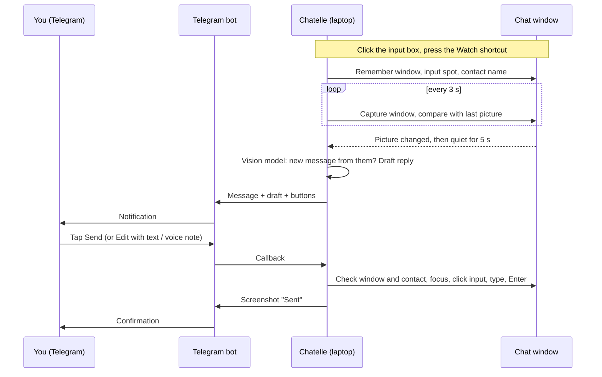

# Remote reply over Telegram (design)

**Status:** 💡 design agreed, not started · Feature idea #14 in [FEATURE_IDEAS.md](FEATURE_IDEAS.md)

## What it does

You leave a chat open on the laptop and walk away. When the other person writes, Chatelle sends their message and a drafted reply to your Telegram. You tap **Send**, or change the reply first by text or voice note. The laptop types it into the chat and presses Enter, then sends you a screenshot as proof.

It works with any app or website that has a chat box, because it only uses the screen, the mouse and the keyboard, never a chat API.

## Decisions

| Topic                 | Decision                                                                                                                     |
| --------------------- | ---------------------------------------------------------------------------------------------------------------------------- |
| Where it works        | Any window with a chat box                                                                                                   |
| Phone                 | iPhone and Android, through Telegram                                                                                         |
| Channel               | Your own Telegram bot (made with @BotFather). The token is saved in Settings, and the bot only answers your Telegram account |
| What is watched       | The window in front when Watch mode starts, even if other windows cover it later                                             |
| Turning it on and off | A shortcut on the laptop; `/start` and `/stop` from Telegram                                                                 |
| Input box             | You click the chat's input box, then press the Watch shortcut. Chatelle remembers that spot                                  |
| Detecting messages    | Compare the window picture every 3 s (free). Call the vision model only after a change, once the window is quiet for 5 s     |
| Notification          | The new message as text, a drafted reply, and buttons **Send · Regenerate · Edit · Ignore · Show screen**                    |
| Sending               | Bring the window to the front, click the remembered input spot, type key by key, press Enter, send back a screenshot         |
| Safety before sending | Abort and tell you if the window is gone or another contact is open                                                          |
| Edit                  | Tap Edit, then send text or a voice note. The bot shows the final text with **Send · Cancel**                                |
| Voice notes           | Transcribed on the laptop with the local speech model. You confirm the text before it is sent                                |
| When you come back    | Touching the keyboard or mouse pauses Watch mode, and Telegram tells you                                                     |
| Laptop                | Kept awake and unlocked while watching                                                                                       |
| Platforms             | macOS first, then Windows                                                                                                    |

## Flow

## Parts

### 1. Watcher (new `src-tauri/src/watch.rs`)

**Starting a session** (new `watch_chat` shortcut action in [`actions.rs`](../src-tauri/src/actions.rs)):

- Find the front window: the front app's pid (`NSWorkspace.frontmostApplication`), then its top window from `CGWindowListCopyWindowInfo`. Keep the window id, pid, app name and bounds.
- Take the mouse position as the input spot (you just clicked there). Save it as an offset from the window's **bottom-left** corner, because input boxes sit at the bottom. That way the spot survives the window moving or growing.
- Capture the window once. Ask the vision model for the contact name and the newest message, then keep both as the baseline.
- Start a `caffeinate -di` child process to keep the display awake. Kill it when the session ends.
- Tell Telegram: "Watching _Safari_, chat with _Anna_."

**Watch loop** (its own thread, every 3 s):

- Capture only that window with `screencapture -x -o -l <window id>`. This works while other windows cover it, but not while it is minimized.
- Shrink the picture to a small grayscale thumbnail and compare it with the last one. Mask a band around the input spot so a blinking cursor is not counted as a change.
- After a change, wait until the window has been quiet for 5 s, so a burst of messages becomes one notification.
- Ask the vision model for `{ "new_message": bool, "from_them": bool, "text": "...", "contact": "..." }`. Skip the notification if the message is not new, is from you, or matches the last message already reported.
- Draft the reply with the existing pipeline, so the same filters and rewrites apply. This needs a small refactor of [`reply.rs`](../src-tauri/src/reply.rs): split `draft_reply_from_screen()` into capture plus `draft_reply_from_image(jpeg)`.
- If drafting fails (for example, every provider's limit is used up), still notify, with a screenshot and "No draft: <reason>".

**Pausing:**

- While Chatelle is sending, the loop is paused and a new baseline is taken afterwards, so your own sent message never triggers a notification.
- "You came back" means real keyboard or mouse input. Use `CGEventSourceSecondsSinceLastEventType` and ignore the seconds around Chatelle's own typing and clicks.

### 2. Telegram bot (new `src-tauri/src/telegram.rs`)

- **Connection:** use the Bot API with `ureq` (already a dependency). Long-poll `getUpdates` with a 30-second timeout on its own thread. No server is needed.
- **Token:** saved with the existing Keychain / Credential Manager helpers in `reply.rs`, under its own service name. Move those helpers into a shared module.
- **Pairing:** after the token is saved, Settings shows a 6-digit code. Send `/pair <code>` to the bot. Your Telegram user id is then saved, and updates from every other user are ignored.
- **Commands:**
  - `/start` resumes the last watch session.
  - `/stop` ends it.
  - `/status` says what is being watched.
  - `/screen` sends a screenshot of the window.
- **New message alert:** `sendMessage` with an inline keyboard. When the state changes (sending, sent, aborted), update the same message with `editMessageText` instead of sending a new one.
- **Screenshots:** `sendPhoto`, sent as a hand-built multipart body because ureq 3 has no multipart helper.
- **Voice notes:** `getFile`, then download the `.oga` file (Opus audio in an Ogg container), decode it to 16 kHz mono, and run the transcription manager. The bot replies "I heard: …" with **Send · Cancel**.
- **Replies in flight:** one pending reply at a time, tracked by Telegram message id. A newer incoming message replaces it (its buttons say "Out of date").

### 3. Sending

1. Check the window id still exists and is not minimized. If not, abort: "The chat window is closed."
2. Capture it and ask the vision model for the contact name. If it differs from the session's contact, abort: "Anna's chat is no longer open (Ben's is)."
3. Bring the app to the front (`NSRunningApplication.activate`) and raise the window with the Accessibility `AXRaise` action. Chatelle already has Accessibility permission.
4. Click the remembered input spot with enigo, wait 300 ms, then type with the existing paced typing (`clipboard::paste`), and press Enter.
5. Wait 1.5 s, capture the window, and send it with `sendPhoto`: "Sent ✅".

### 4. Settings and tray

- **New panel** `src/components/settings/RemoteReplyPanel.tsx`:
  - bot token field
  - pairing code and status
  - Watch shortcut
  - a warning that the laptop stays awake and unlocked while watching
- **Tray:** "Watching: Safari · Anna" with a **Stop watching** item.
- All strings go in `src/i18n/locales/en/translation.json`.

## Security and privacy

- The bot only answers the paired Telegram user id, and the token is saved in the Keychain.
- Nothing is sent without your tap, and every send is checked against the window and contact first.
- **While watching, the laptop is awake and unlocked.** Anyone near it can use it. Settings and the start message say so.
- Chat text and screenshots go to Telegram's servers and to the vision model provider.
- Some chat platforms forbid automated replies. Check the rules of the one you use.

## Edge cases

| Case                                      | Behaviour                                                                               |
| ----------------------------------------- | --------------------------------------------------------------------------------------- |
| Window minimized or closed                | Stop the loop and tell Telegram                                                         |
| Lid closed / Mac sleeps                   | `caffeinate` cannot stop a closed lid. When it wakes, tell Telegram it slept            |
| Several displays                          | Capture by window id, so the display does not matter                                    |
| Screen Recording permission missing       | Refuse to start, and say why in Settings and the overlay                                |
| Internet down                             | Keep retrying `getUpdates`, and keep the latest alert to send once back                 |
| Two messages before you answer            | The newer alert replaces the older one; the older buttons say "Out of date"             |
| Enter makes a new line instead of sending | Shown by the confirmation screenshot. A later version can click the send button instead |

## Phases

1. **Notify.** Bot token and pairing, the watcher, and alerts with the message and draft, plus **Show screen**, **Ignore**, `/start`, `/stop` and `/status`.
2. **Send.** **Send** and **Regenerate**, the safety checks, typing plus Enter, and the confirmation screenshot.
3. **Edit.** Edit by text and by voice note (Ogg/Opus decoding plus local transcription).
4. **Polish.** Pausing when you come back, the tray status, and the Windows port: `Windows.Graphics.Capture` for window capture, `SetForegroundWindow` to bring the window to the front.

## Open questions

- **Opus decoding:** `ogg` plus `audiopus` (binds the C libopus library) or a pure-Rust decoder. Pick one in phase 3.
- **One vision call or two?** The "new message?" check and the draft might fit in one vision request to save quota. Test after phase 1.
- **Contact check:** a vision call before each send costs quota. Comparing a crop of the chat header is cheaper, but online/typing status changes it. Start with the vision call.
